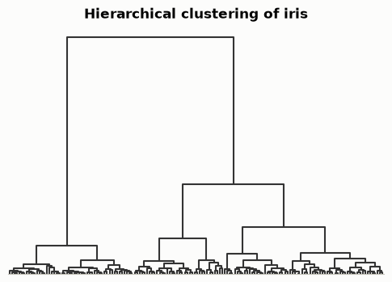

# Hierarchical Clustering (ClusterHclust)

## About the method
- `ClusterHclust`: agglomerative hierarchical clustering.

## Didactic goal
Keep the same clustering line of experiment and add a hierarchy that can be inspected before or after cutting the tree into clusters.

## Environment setup


```python
import warnings

import pandas as pd

import pydaltoolbox as dal

warnings.filterwarnings("ignore")
```

## Load data; keep reference labels only for interpretation


```python
iris = dal.datasets.iris()
x = iris.drop(columns="Species")
ref = iris["Species"]
x.head()
```


       sepal_length  sepal_width  petal_length  petal_width
    0           5.1          3.5           1.4          0.2
    1           4.9          3.0           1.4          0.2
    2           4.7          3.2           1.3          0.2
    3           4.6          3.1           1.5          0.2
    4           5.0          3.6           1.4          0.2


## Model configuration


```python
model = dal.ClusterHclust(k=3, method="ward")
```

## Fit the model and obtain cluster labels


```python
model = model.fit(x)
clu = model.cluster(x)
pd.Series(clu).value_counts().sort_index()
```


    0    71
    1    49
    2    30
    Name: count, dtype: int64


## Evaluate the partition


```python
model.evaluate(clu, ref)["metrics"]
```


                    metric       value      goal      type
    0           silhouette    0.503050  maximize  internal
    1       davies_bouldin    0.682640  minimize  internal
    2    calinski_harabasz  430.902102  maximize  internal
    3              entropy    0.542245  minimize  external
    4               purity    0.826667  maximize  external
    5  adjusted_rand_index    0.615323  maximize  external


## Inspect the hierarchy graphically (needs the optional `[viz]` extra)


```python
from scipy.cluster.hierarchy import linkage

ax = dal.plot_dendrogram(
    linkage(x.to_numpy(), method="ward"),
    labels=False,
    title="Hierarchical clustering of iris",
)
ax.figure
```


    

    


    

    


## References
- Johnson, S. C. (1967). *Hierarchical Clustering Schemes.*
