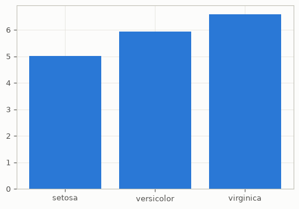

# Bar Chart (plot_bar)

## About the chart
- Bar: compares aggregated values by categories. Useful for means, counts, and totals by group.

## Didactic goal
Treat the plot as an analytical tool, not decoration: ask what question the chart answers and how the input data must be organized before plotting.

## Environment setup


```python
import pydaltoolbox as dal

iris = dal.datasets.iris()
```

## Aggregate by `Species`


```python
agg = iris.groupby("Species", as_index=False)["sepal_length"].mean()
agg
```

    C:\Users\eduar\AppData\Local\Temp\ipykernel_2928\2622842540.py:1: FutureWarning: The default of observed=False is deprecated and will be changed to True in a future version of pandas. Pass observed=False to retain current behavior or observed=True to adopt the future default and silence this warning.
      agg = iris.groupby("Species", as_index=False)["sepal_length"].mean()
    


          Species  sepal_length
    0      setosa         5.006
    1  versicolor         5.936
    2   virginica         6.588


## Basic bar chart (one colour, then one colour per species)


```python
ax = dal.plot_bar(agg, colors="#2a78d6")
ax.figure
```


    

    


    

    


## Colour each bar by species


```python
ax = dal.plot_bar(agg, colors=["#2a78d6", "#eb6834", "#1baf7a"])
ax.figure
```


    

    


    

    


## References
- Wickham, H. (2016). *ggplot2: Elegant Graphics for Data Analysis.* Springer.
- Cleveland, W. S. (1994). *The Elements of Graphing Data* (2nd ed.). Hobart Press.
