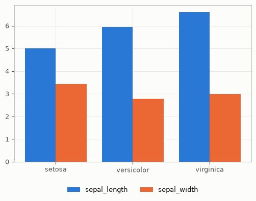

# Grouped Bar Chart (plot_groupedbar)

## About the chart
- Grouped bars: compares multiple measures per category, displaying side-by-side bars.

## Environment setup


```python
import pydaltoolbox as dal

iris = dal.datasets.iris()
```

## Aggregate two metrics by species


```python
agg = iris.groupby("Species", as_index=False)[["sepal_length", "sepal_width"]].mean()
agg
```

    C:/Users/eduar/AppData/Local/Temp/ipykernel_34384/3211397133.py:1: FutureWarning: The default of observed=False is deprecated and will be changed to True in a future version of pandas. Pass observed=False to retain current behavior or observed=True to adopt the future default and silence this warning.
      agg = iris.groupby("Species", as_index=False)[["sepal_length", "sepal_width"]].mean()
    


          Species  sepal_length  sepal_width
    0      setosa         5.006        3.428
    1  versicolor         5.936        2.770
    2   virginica         6.588        2.974


## Build a grouped bar chart


```python
ax = dal.plot_groupedbar(agg)
ax.figure
```


    

    


    

    


## References
- Wickham, H. (2016). *ggplot2: Elegant Graphics for Data Analysis.* Springer.
- Cleveland, W. S. (1994). *The Elements of Graphing Data* (2nd ed.). Hobart Press.
