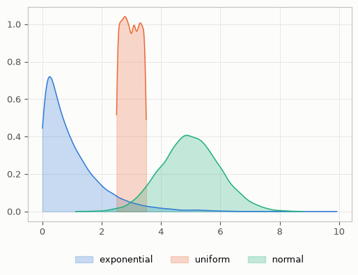

# Density Plot (plot_density)

## About the chart
- Density (kernel density): a smoothed version of the histogram for continuous variables; highlights distribution shapes.

## Environment setup


```python
import numpy as np
import pandas as pd

import pydaltoolbox as dal
```

## Generate variables with distinct distributions


```python
rng = np.random.default_rng(1)
example = pd.DataFrame({
    "exponential": rng.exponential(1.0, 10000),
    "uniform": rng.uniform(2.5, 3.5, 10000),
    "normal": rng.normal(5.0, 1.0, 10000),
})
example.head()
```


       exponential   uniform    normal
    0     1.073029  2.807068  3.867724
    1     0.308453  3.062785  5.051074
    2     5.375437  3.443158  5.637334
    3     0.366427  3.028611  4.689365
    4     0.115362  2.517028  4.907643


## Overlaid density curves


```python
ax = dal.plot_density(example)
ax.figure
```


    

    


    

    


## References
- Silverman, B. W. (1986). *Density Estimation for Statistics and Data Analysis.* Chapman and Hall.
- Wickham, H. (2016). *ggplot2: Elegant Graphics for Data Analysis.* Springer.
