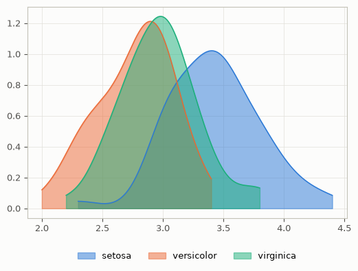

# Density by Class (plot_density_class)

## About the chart
- `plot_density_class`: density curves grouped by class.

## Didactic goal
Show how grouped density views help compare overlap and separation between classes more smoothly than grouped histograms.

## Environment setup


```python
import pydaltoolbox as dal

iris = dal.datasets.iris()
```

## Grouped density of sepal width by species


```python
ax = dal.plot_density_class(iris[["sepal_width", "Species"]], class_label="Species")
ax.figure
```


    

    


    

    


## References
- Silverman, B. W. (1986). *Density Estimation for Statistics and Data Analysis.* Chapman and Hall.
