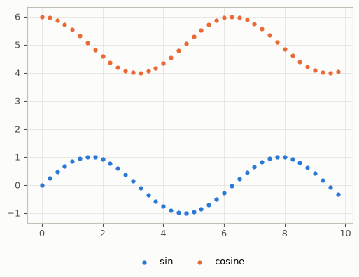

# Point Chart (plot_points)

## About the chart
- Points: similar to a series, but without connecting lines; good to highlight discrete observations.

## Environment setup


```python
import numpy as np
import pandas as pd

import pydaltoolbox as dal
```

## Synthetic series


```python
x = np.arange(0, 10, 0.25)
serie = pd.DataFrame({"x": x, "sin": np.sin(x), "cosine": np.cos(x) + 5})
serie.head()
```


          x       sin    cosine
    0  0.00  0.000000  6.000000
    1  0.25  0.247404  5.968912
    2  0.50  0.479426  5.877583
    3  0.75  0.681639  5.731689
    4  1.00  0.841471  5.540302


## Plot points


```python
ax = dal.plot_points(serie)
ax.figure
```


    

    


    

    


## References
- Wickham, H. (2016). *ggplot2: Elegant Graphics for Data Analysis.* Springer.
