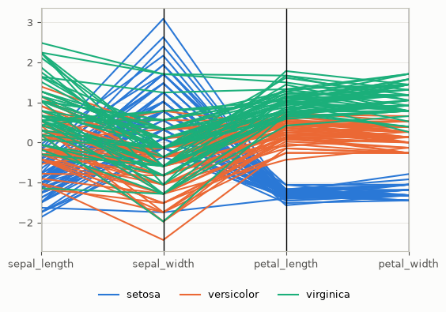

# Parallel Coordinates (plot_parallel)

## About the chart
- `plot_parallel`: parallel coordinates plot for multivariate comparison.

## Didactic goal
Present an alternative to scatter matrices when comparing many numeric attributes simultaneously with class grouping.

## Environment setup


```python
import pydaltoolbox as dal

iris = dal.datasets.iris()
```

## Parallel coordinates coloured by species


```python
ax = dal.plot_parallel(iris, columns=[0, 1, 2, 3], group="Species")
ax.figure
```


    

    


    

    


## References
- Inselberg, A. (1985). *The plane with parallel coordinates.*
- Wickham, H. (2016). *ggplot2: Elegant Graphics for Data Analysis.* Springer.
