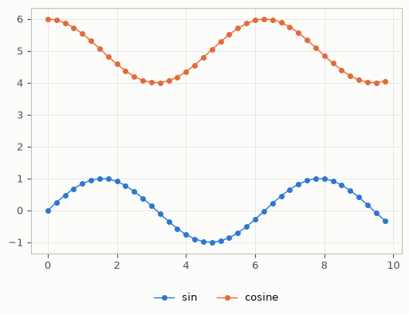

# Exporting a Chart to PDF

## About the feature
- Chart saving: export a figure with `Figure.savefig` to PDF, controlling size and resolution.

## Environment setup


```python
import numpy as np
import pandas as pd

import pydaltoolbox as dal
```


```python
import os
import tempfile
```

## Build a chart


```python
x = np.arange(0, 10, 0.25)
serie = pd.DataFrame({"x": x, "sin": np.sin(x), "cosine": np.cos(x) + 5})
ax = dal.plot_series(serie)
ax.figure
```


    

    


    

    


## Save it as PDF


```python
path = os.path.join(tempfile.gettempdir(), "series.pdf")
ax.figure.savefig(path, bbox_inches="tight")
print("saved", path)
```

    saved C:/Users/eduar/AppData/Local/Temp/series.pdf
    

## References
- Wickham, H. (2016). *ggplot2: Elegant Graphics for Data Analysis.* Springer.
