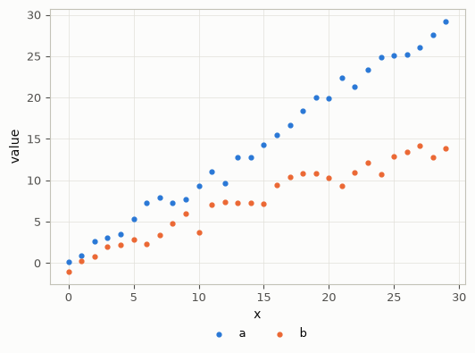

# Exporting a Chart to JPG/PNG

## About the feature
- Chart saving: export a figure to raster formats (JPG, PNG) with `Figure.savefig`.

## Environment setup


```python
import numpy as np
import pandas as pd

import pydaltoolbox as dal
```


```python
import os
import tempfile
```

## Build a chart


```python
rng = np.random.default_rng(0)
x = np.arange(30)
long = pd.DataFrame({
    "x": np.r_[x, x],
    "value": np.r_[x + rng.normal(0, 1, 30), 0.5 * x + rng.normal(0, 1, 30)],
    "variable": ["a"] * 30 + ["b"] * 30,
})
ax = dal.plot_scatter(long, label_x="x", label_y="value")
ax.figure
```


    

    


    

    


## Save it as JPG and PNG


```python
for ext in ("jpg", "png"):
    path = os.path.join(tempfile.gettempdir(), f"series.{ext}")
    ax.figure.savefig(path, dpi=100, bbox_inches="tight")
    print("saved", path)
```

    saved C:\Users\eduar\AppData\Local\Temp\series.jpg
    saved C:\Users\eduar\AppData\Local\Temp\series.png
    

## References
- Wickham, H. (2016). *ggplot2: Elegant Graphics for Data Analysis.* Springer.
